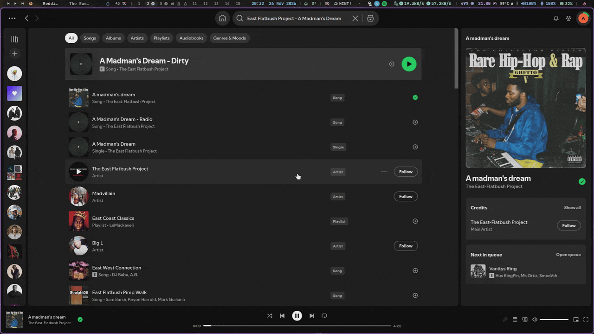

# Spotify Tray for Wayland/Hyprland

Tray icon for the Spotify Linux client on Hyprland. Hide Spotify to the tray, control playback from the icon.



## Features

- **Hover**: current track
- **Scroll down / up**: next / previous track
- **Middle-click**: play / pause
- **Click**: menu with track info, Show/Hide, playback controls, Quit
- **Hide to tray**: Spotify moves to a special workspace instead of closing
- **Auto-start**: tray starts when you launch Spotify from the app menu

## Install

Arch (AUR):

```bash
yay -S spotify-tray-wayland-bin   # prebuilt
yay -S spotify-tray-wayland-git   # from source
```

Other distros:

```bash
git clone https://github.com/xander1421/spotify-tray-wayland.git
cd spotify-tray-wayland
./setup.sh
```

Needs Hyprland (Lua config 0.55+ or legacy `hyprland.conf`), the Spotify client, and a bar with tray support (e.g. Waybar).

## Keyboard shortcuts (optional)

Run `spotify-tray-setup` in a terminal inside Hyprland. It offers:

- **Smart close**: your close shortcut (e.g. Super+Q) hides Spotify to the tray and closes other windows as usual.
- **Workspace shortcut**: Super+` shows or hides Spotify's workspace. Setup checks the shortcut is free first (needs `jq`); pick another or skip if it's taken.

To bind Show/Hide yourself:

```lua
hl.bind("<shortcut>", hl.dsp.exec_cmd("spotify-tray-wayland toggle"))   -- Lua
```

```ini
bind = <mods>, <key>, exec, spotify-tray-wayland toggle   # hyprland.conf
```

## Uninstall

AUR: `yay -R spotify-tray-wayland-bin` (or `-git`). Manual install: `./uninstall.sh`. Both remove the launcher, desktop entry and Hyprland config.

## How it works

- Playback and track info over MPRIS (D-Bus). Only playback methods are allowed through.
- Tray icon via StatusNotifierItem; re-registers if the bar restarts.
- Window show/hide over Hyprland's IPC socket, no `hyprctl` subprocesses.
- Reconnects after suspend/resume and D-Bus or Hyprland restarts.

## Troubleshooting

- **No tray icon**: check your bar has a tray module and `pgrep -f spotify-tray-wayland` shows the process.
- **No track info**: Spotify must be running.
- **Show/Hide does nothing**: needs Hyprland; check `hyprctl clients | grep -i spotify`.

## Build

```bash
cd spotify-tray-wayland && go build -o spotify-tray-wayland .
```

## License

GPL-3.0. Unofficial, not affiliated with Spotify. Spotify is a trademark of Spotify AB.
